<!-- ╔══════════════════════════════════════════════════════════════╗ -->
<!-- ║  ERAMIYA VIMALANTHAN - PIXEL AESTHETIC GITHUB PROFILE       ║ -->
<!-- ╚══════════════════════════════════════════════════════════════╝ -->

<div align="center">
  
</div>

<br/>

<!-- ═══════════════ SPIDER + TYPING AREA ═══════════════ -->



<div align="center">
  <a href="https://git.io/typing-svg">
    
  </a>
</div>

<br/>

<div align="center">
  
</div>

<!-- ═══════════════ PLAYER SELECT / ABOUT ME ═══════════════ -->

##  

```
╔══════════════════════════════════════════════════════════╗
║                                                          ║
║   > PLAYER: ERAMIYA VIMALANTHAN                          ║
║   > CLASS:  AI/ML Engineer + Full Stack Developer        ║
║   > GUILD:  St. Joseph's Institute of Technology         ║
║   > RANK:   B.Tech - AI & Data Science                   ║
║   > STATUS: ████████████░░ [LEVELING UP...]              ║
║                                                          ║
║   TRAITS:                                                ║
║   [■] Hackathon Champion (Edge-AI Industrial Safety)     ║
║   [■] AI/ML Enthusiast with hands-on project experience  ║
║   [■] Full-Stack problem solver & creative developer     ║
║   [■] Adobe Creative Suite power user                    ║
║   [■] Always learning, always shipping                   ║
║                                                          ║
╚══════════════════════════════════════════════════════════╝
```

<div align="center">
  
</div>

<!-- ═══════════════ SKILL TREE ═══════════════ -->

## 

<details open>
<summary><b>⚔️ LANGUAGES</b></summary>
<br/>
<p align="center">


</p>
</details>

<details open>
<summary><b>🧠 AI / ML ARSENAL</b></summary>
<br/>
<p align="center">


</p>
</details>

<details open>
<summary><b>🌐 WEB & FRAMEWORKS</b></summary>
<br/>
<p align="center">


</p>
</details>

<details open>
<summary><b>☁️ CLOUD & DATABASE</b></summary>
<br/>
<p align="center">


</p>
</details>

<details open>
<summary><b>🎨 CREATIVE TOOLS</b></summary>
<br/>
<p align="center">


</p>
</details>

<details open>
<summary><b>🔧 DEV TOOLS</b></summary>
<br/>
<p align="center">


</p>
</details>

<div align="center">
  
</div>

<!-- ═══════════════ QUEST LOG / FEATURED PROJECTS ═══════════════ -->

## 

<table>
<tr>
<td width="50%" valign="top">

### 🏆 Edge-AI Industrial Safety
**`>>> HACKATHON WINNER <<<`**

Edge-AI Based Industrial Safety Violation Detection System. Real-time safety compliance monitoring using AI at the edge.

[](https://github.com/ERAMIYA-VIMALANATHAN/Edge-AI-Based-Industrial-Safety-Violation-Detection-System)
[](https://github.com/ERAMIYA-VIMALANATHAN/Edge-AI-Based-Industrial-Safety-Violation-Detection-System)

</td>
<td width="50%" valign="top">

### 🤖 AI Interview Agent
**`>>> VOICE + TEXT SIMULATOR <<<`**

AI-powered mock interview simulator with strict AI teacher persona, rubric-based evaluation, and personalized career roadmaps.

[](https://github.com/ERAMIYA-VIMALANATHAN/Ai-Interview-agent)
[](https://github.com/ERAMIYA-VIMALANATHAN/Ai-Interview-agent)

</td>
</tr>
<tr>
<td width="50%" valign="top">

### 🔬 Lung Histopathology
**`>>> MEDICAL AI <<<`**

Deep learning model for lung cancer histopathological image classification and analysis.

[](https://github.com/ERAMIYA-VIMALANATHAN/Lung-Histopathalogy)
[](https://github.com/ERAMIYA-VIMALANATHAN/Lung-Histopathalogy)

</td>
<td width="50%" valign="top">

### 👁️ Age Detection
**`>>> COMPUTER VISION <<<`**

Real-time age detection system using computer vision and deep learning techniques.

[](https://github.com/ERAMIYA-VIMALANATHAN/AGE-DETECTION)
[](https://github.com/ERAMIYA-VIMALANATHAN/AGE-DETECTION)

</td>
</tr>
<tr>
<td width="50%" valign="top">

### 📋 Smart Attendance System
**`>>> AUTOMATION <<<`**

Intelligent attendance management system with automated tracking and reporting.

[](https://github.com/ERAMIYA-VIMALANATHAN/SMART-ATTENDANCE-SYSTEM)
[](https://github.com/ERAMIYA-VIMALANATHAN/SMART-ATTENDANCE-SYSTEM)

</td>
<td width="50%" valign="top">

### 🗾 JLPT N5 Exam Trainer Bot
**`>>> LANGUAGE LEARNING <<<`**

Interactive Japanese language learning bot for JLPT N5 exam preparation.

[](https://github.com/ERAMIYA-VIMALANATHAN/Japanese_JLPT_N5_exam-trainer-bot)
[](https://github.com/ERAMIYA-VIMALANATHAN/Japanese_JLPT_N5_exam-trainer-bot)

</td>
</tr>
</table>

<div align="center">
  
</div>

<!-- ═══════════════ BATTLE STATS ═══════════════ -->

## 

<div align="center">
  
  
</div>

<br/>

<div align="center">
  
</div>

<br/>

<!-- Activity Graph -->
<div align="center">
  
</div>

<div align="center">
  
</div>

<!-- ═══════════════ CONTRIBUTION SNAKE ═══════════════ -->

## 

<div align="center">
  <picture>
    <source media="(prefers-color-scheme: dark)" srcset="https://raw.githubusercontent.com/ERAMIYA-VIMALANATHAN/ERAMIYA-VIMALANATHAN/output/github-snake-dark.svg" />
    <source media="(prefers-color-scheme: light)" srcset="https://raw.githubusercontent.com/ERAMIYA-VIMALANATHAN/ERAMIYA-VIMALANATHAN/output/github-snake.svg" />
    
  </picture>
</div>

> 💡 *Set up the [snk](https://github.com/Platane/snk) GitHub Action to generate this snake animation automatically!*

<div align="center">
  
</div>

<!-- ═══════════════ TROPHIES ═══════════════ -->

## 

<div align="center">
  
</div>

<div align="center">
  
</div>

<!-- ═══════════════ CONNECT / SOCIALS ═══════════════ -->

## 

<div align="center">

```
╔══════════════════════════════════════════╗
║     >>> CONNECT WITH ME <<<              ║
╚══════════════════════════════════════════╝
```

<a href="https://www.linkedin.com/in/eramiya-vimalathan-m/">
  
</a>
<a href="mailto:eramiyavimalanathan@gmail.com">
  
</a>
<a href="https://leetcode.com/u/Eramiya_Vimlanathan_9767/">
  
</a>
<a href="https://www.skillrack.com/faces/resume.xhtml?id=493879&key=8ae8474c5217fc8c2d958de92e74bc385a1139a0">
  
</a>

</div>

<br/>

<!-- ═══════════════ VISITOR COUNTER ═══════════════ -->

<div align="center">
  
  
  
</div>

<br/>

<!-- ═══════════════ FOOTER ═══════════════ -->

<div align="center">
  
</div>

<div align="center">

```
░░░░░░░░░░░░░░░░░░░░░░░░░░░░░░░░░░░░░░░░░░░░░░░░░░░░░░░░░░░░░░░░
░░                                                              ░░
░░   "In the world of code, every pixel tells a story."         ░░
░░                                                              ░░
░░░░░░░░░░░░░░░░░░░░░░░░░░░░░░░░░░░░░░░░░░░░░░░░░░░░░░░░░░░░░░░░
```

</div>

<!-- ═══════════════ GAME OVER ═══════════════ -->

<div align="center">
  
</div>
